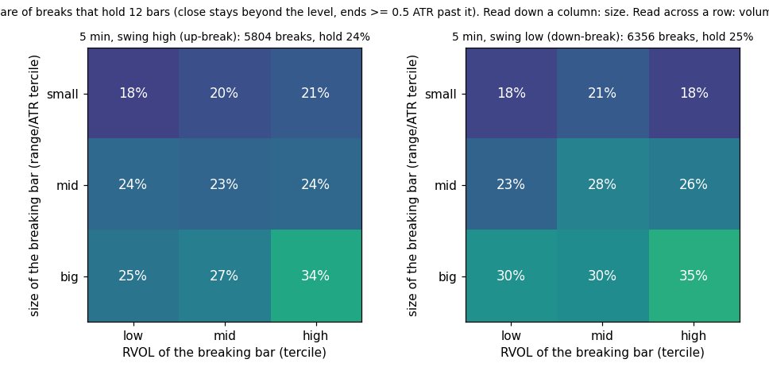
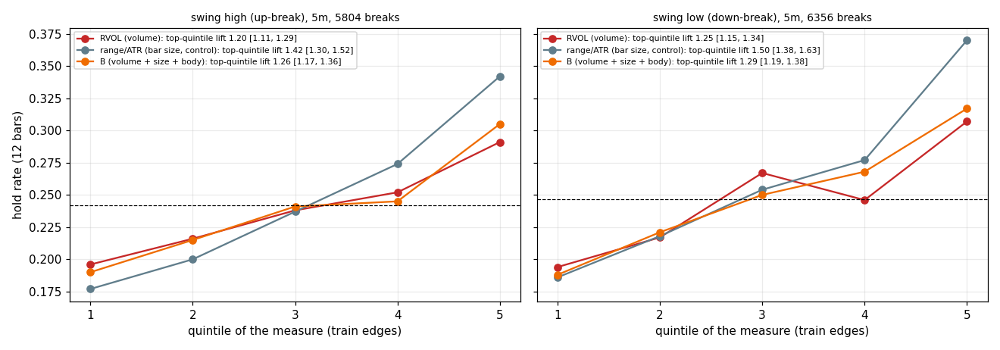
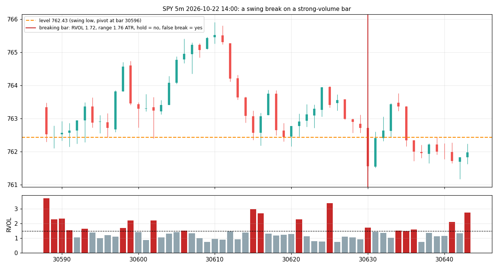

# Breaking a swing high or low with a strong bar: result

**The bar's size does the work; volume adds a little, and only when the bar is already big.** Formal label by the
pre-registered rule: **no** (the rule needed 5m and 15m, and 15m has too few measurable events; see PREREG changes).
On 5m, where 12,160 swing breaks were measured on test days, the picture is clear and consistent across up-breaks,
down-breaks, pivot widths (k = 2 and 5) and symbol groups.

## What a trader should expect (5m, test days 2026-03-10 onwards, 30 SIP symbols; `grid.png`)
| breaking bar | hold rate (close stays beyond the level 12 bars and ends ≥ 0.5 ATR past it) |
|---|---|
| any break of a swing high / low | **24% / 25%** (3 of 4 breaks fail) |
| small bar (bottom tercile of range/ATR) | 18–21% |
| big bar (top tercile), low volume | 25% / 30% |
| **big bar, high volume** (top terciles of both) | **34% / 35%** |
| top quintile of bar size (the control) | lift **1.42 [1.30, 1.52]** / **1.50 [1.38, 1.63]** |
| top quintile of RVOL (volume) | lift 1.20 [1.11, 1.29] / 1.25 [1.15, 1.34] |
| volume minus size, paired | **−0.21 [−0.33, −0.09]** / **−0.26 [−0.39, −0.12]**: volume is the weaker of the two |
| B (volume + size + body) | 1.26 / 1.29, also below size alone |

Read the grid by rows: inside each bar-size tercile, going from low to high volume adds 2–8 points; the biggest add is
in the big-bar row (25% → 34% on swing highs, 30% → 35% on swing lows). Read it by columns: inside each volume
tercile, going from small to big bars adds 7–16 points. Size first, volume second.

Same ordering on prior-day high / low, POC / VAH / VAL and the GEX walls (600–700 events each on 5m; size lift
1.24–1.52, volume 1.05–1.29, every paired difference negative or zero). k = 5 pivots: the same as k = 2.
Groups: size beats volume in index ETFs (1.50 vs 1.44), mega-caps (1.55 vs 1.19) and high-beta (1.32 vs 1.17).

## False breaks (close back across the level within 3 bars): about half of all breaks
Absorption bars (RVOL > 1.5 with range/ATR < 0.7, 2% of breaks): false-break rate **65% [57, 72] vs 51%** on swing
highs; 56% [49, 64] vs 50% on swing lows (intervals touch). A warning in one direction, suggestive in the other; the
pre-registered "both timeframes" condition cannot be met on 15m, so no warning marker is shipped.

## Hypotheses
- H1 big breaking bars hold more: **confirmed** (lift 1.42–1.55 on every swing type, intervals well above 1).
- H2 volume adds to size: **rejected** as stated (volume's lift is below size's); it adds inside the big-bar bucket
  only, +9 points on swing highs, +5 on swing lows (not pre-registered as a test, reported).
- H3 absorption bars produce more false breaks: **confirmed on swing highs**, borderline on swing lows.
- H4 the effect is larger on swing levels than on value-area levels: not supported (size lift 1.42–1.50 on swings vs
  1.24–1.52 on day levels; volume 1.20–1.25 vs 1.05–1.29); the same picture everywhere.
- H5 down-breaks on volume hold more than up-breaks: no (volume lift 1.25 vs 1.20, size 1.50 vs 1.42; a small edge to
  down-breaks for both, within the intervals).
- H6 levels touched 3+ times break-and-hold more often: **rejected** (24.4% / 25.4% / 23.0% for 1 / 2 / 3+ touches).

## Timeframes
15m: 18 and 35 swing breaks with a full 12-bar outcome on test days (a level needs 10 bars of age and the hold 12
more, inside a 26-bar session): nothing can be said; day levels on 15m have 90–120 events with intervals from 0.3 to
3. 1h: no measurable events.

## Planted tests (`planted.json`)
W1 (no relation): no volume measure beats the size control. W2 (2× plant): RVOL's top quintile recovers 69% of the
planted lift, just under the 70% line; W2b (3× plant, same prices): 92%. The pipeline is sound; the 2× miss is the
synthetic volume noise, not the measurement.

## Not shipped
No marker, no panel line (the rule required "works" or "size only" on both timeframes). Pine unchanged (v41).
If a marker on **bar size alone** is wanted on the 5m evidence (12,160 breaks, every group, both pivot widths), it
would read "اختراق بشمعة كبيرة: يثبت 34% بدل 24%" and must say it was measured on 5m only.

