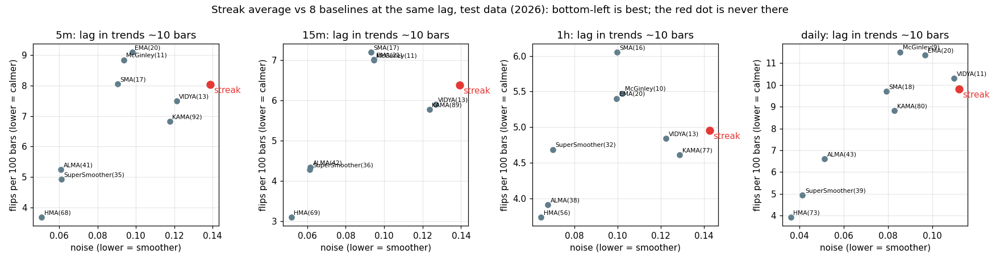

# Colour-streak average for Heikin Ashi: result

**Verdict: worse.** It passed the planted test but loses to the best ordinary average on real data, on every
timeframe, under both lag measures. Per PREREG_STREAK, no Pine line.

## Step 2, planted gate (fresh seeds 10000..10199): passed
Chosen on seen seeds: cap 10, p 2, fast 5, slow 100. Against EMA(15) of HA close at the same trend lag (7.75):
false flips 12.6 vs 17.5 per 100 sideways bars, **28% fewer (95% interval 26% to 29%)**; dent from one strong red
candle 0.05 vs 0.12 sigma; noise test passes.

## Step 3, real SIP bars, test 40% of days, 30 symbols
Matched by lag inside trends (the fair one for this average; `streak_verdict_trend.json`, chart below):

| tf | streak flips / noise | best baseline flips / noise | vs EMA (flips, noise) |
|---|---|---|---|
| 5m | 8.05 / 0.139 | HMA(68) 3.67 / 0.051 | +12% fewer flips, 41% more noise |
| 15m | 6.38 / 0.139 | HMA(69) 3.09 / 0.052 | +9%, 47% more noise |
| 1h | 4.95 / 0.142 | HMA(56) 3.74 / 0.065 | +8%, 43% more noise |
| daily | 9.81 / 0.112 | HMA(73) 3.92 / 0.036 | (worse) |

Under the pre-registered drift-lag matching (`streak_verdict.json`) it is worse by more on all four.
Intervals for every "worse" exclude zero.

## Why
It switches between a fast (5) and a slow (100) speed with every colour streak. Inside a range that switching makes
the line bend often (noise 40% to 170% above every baseline). The planted series had sharp, clean regimes, where
switching pays; real 5-minute to daily prices do not.

## What was not done (on purpose)
Pine line, parity, screenshot: conditional on "better" or "equal".

