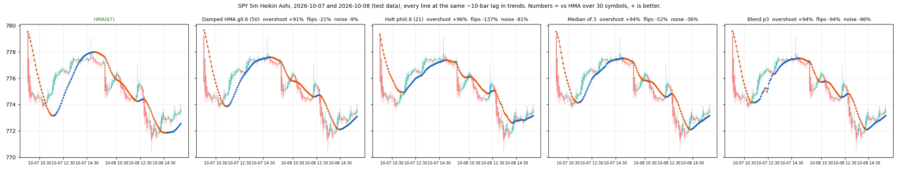
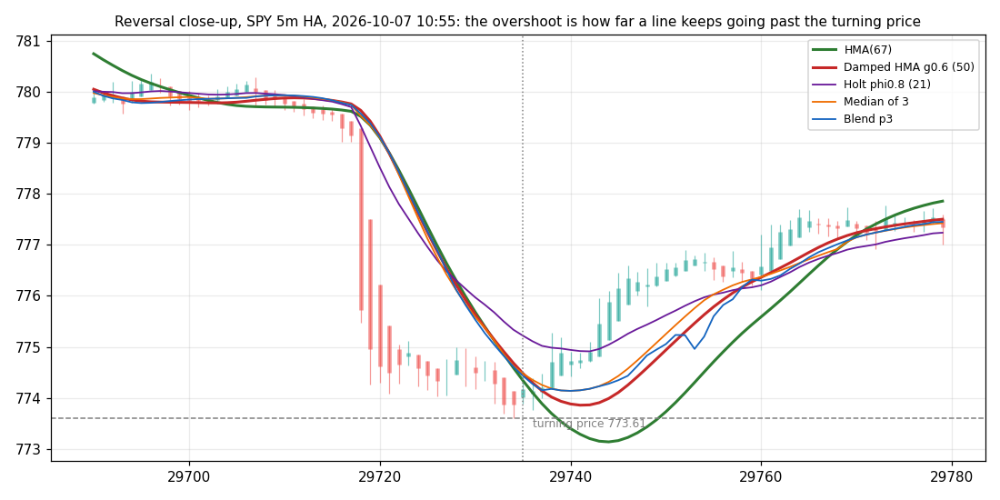
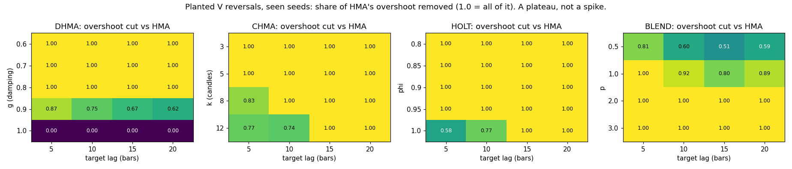

# HMA successor for Heikin Ashi: result

**Verdict by the pre-registered rule: worse, for all four candidates, on all four timeframes. HMA(68) stays.**
They all remove 90% or more of HMA's overshoot at reversals and turn 10–35% earlier, but each one also flips more
often than the rule allows (not worse than 10%). The reversal fix costs calm in the ranges.

## Step 1, shape per candidate (planted V reversals, seen seeds 0..99, `select.json`, `heatmap.png`)
Reference HMA at a 10-bar trend lag: n = 166 on the planted series, overshoot 0.72 ATR, turn delay 17.5 bars.
Chosen: damped HMA g = 0.6, damped Holt phi = 0.8, median of three, blend p = 3. **Clamped HMA failed** the flips
constraint at every k (clamping to the candle range makes the line bounce inside a range: 67–75 flips vs 52).

## Step 2, gate (fresh seeds 10000..10199, `gate.json`): all four pass
Overshoot cut vs HMA: DHMA 87% [81, 92], HOLT 95% [91, 98], MED3 90% [85, 94], BLEND 88% [82, 93]; turn delay and
sideways flips within the limits.

## Step 3, real SIP data, test days (2026-03-10 onwards), 30 symbols, at a 10-bar trend lag (`verdict.json`)
Numbers are "vs HMA", + = better, 95% intervals over symbol-days. Reversals: 5,810 on 5m, 2,029 on 15m, 578 on 1h,
89 daily.

| tf | candidate | overshoot | turn delay | flips | noise | verdict |
|---|---|---|---|---|---|---|
| 5m | damped HMA g0.6 (50) | +91% [89, 92] | +17% | **−21%** [−23, −20] | −9% | worse |
| 5m | Holt phi0.8 (21) | +96% | +35% | −137% | −81% | worse |
| 5m | median of 3 | +94% | +23% | −52% | −36% | worse |
| 5m | blend p3 | +94% | +25% | −94% | −96% | worse |
| 15m | damped HMA | +91% | +15% | −21% | −12% | worse |
| 1h | damped HMA | +95% | +10% | **−10%** [−15, −6] | −1% | worse (flips lower bound −15%) |
| daily | damped HMA | +93% (interval n/a, 89 reversals) | +19% | −24% | −18% | worse |

Holt, the median and the blend are far outside the bound everywhere. The damped HMA is the only one close to it.
Groups on 5m (index ETFs / mega-caps / high-beta): the same picture in each, overshoot +91..94%, flips −21..−23%.

## Hypotheses
- H1 (damping reduces overshoot monotonically): **confirmed** (sweep below: 0.174 → 0.120 → 0.086 → 0.062 → 0.050 →
  0.026 → 0.016 ATR for g = 1 → 0.6).
- H2 (clamp removes ≥ 50% overshoot at < 0.5 bar lag): **rejected** on the flips side; the clamp never reached step 2.
- H3 (Holt phi 0.9 matches the lag with less overshoot): lag matched and overshoot −96%, but flips more than double:
  **rejected** as a usable average.
- H4 (median of three beats each member on overshoot without more noise): overshoot yes, noise **no** (+36%).
- H5 (gains hold on every timeframe and group): the direction holds everywhere; so does the cost.

## What was learned (exploratory, after the verdict: `sweep_5m.json`, not a result)
The damping g is the one knob that matters, and it is smooth:

| g | length at 10-bar lag | overshoot (ATR) | turn delay | flips vs HMA | noise vs HMA |
|---|---|---|---|---|---|
| 1.00 (HMA) | 67 | 0.174 | 9.6 | 0 | 0 |
| 0.95 | 64 | 0.120 (−31%) | 9.5 | −2% | +1% |
| 0.90 | 60 | 0.086 (−51%) | 9.0 | −6% | −2% |
| 0.85 | 58 | 0.062 (−64%) | 8.9 | −8% | −2% |
| 0.80 | 57 | 0.050 (−71%) | 8.7 | −10% | −3% |
| 0.60 | 50 | 0.016 (−91%) | 7.9 | −20% | −9% |

g ≈ 0.85–0.9 would sit **inside** the pre-registered "not worse" bound while cutting half to two thirds of the
overshoot. That point was not pre-registered (the planted series could not separate g values, see PREREG changes),
and these numbers were seen on the test data, so they cannot be claimed. The next attempt should pre-register
damped HMA with g = 0.85 against HMA, on data after 2026-10-24, with a planted series hard enough (more noise, shorter
trends) to separate the g values before the real test.

## Not done (on purpose)
Pine line, parity, screenshot: conditional on "better" or "equal" on all four timeframes.

