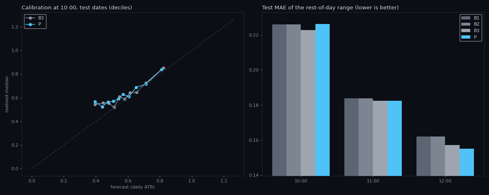
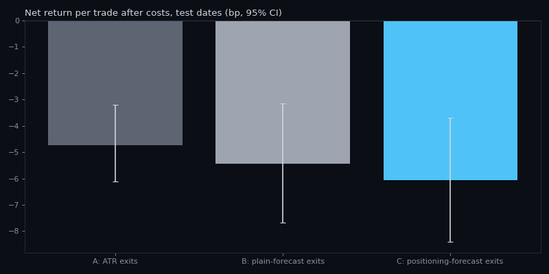

# Positioning-conditioned range engine: result

## Verdict: does not clear the bar

Both pre-registered claims (PREREG.md, committed before any fitting) failed on the test dates, and the prior-art
review (PRIOR_ART.md) found every element of the method already published or sold. **No patent claims are drafted**:
a claim set for a method that is neither new nor shown to work would mislead whoever files it.

| Pre-registered test | Threshold | Result |
|---|---|---|
| Claim 1: positioning improves the 10:00 rest-of-day range forecast over the plain regression | lowest MAE of the four models, interval above zero, >= 2% | **Failed.** Positioning model is 1.5% *worse* (interval -0.0060 to -0.0009 daily ATR) |
| Claim 1 at 11:00 (reported) | — | No difference (0.0%, interval -0.0025 to +0.0024) |
| Claim 1 at 12:00 (reported) | — | 1.4% better (interval +0.0001 to +0.0043): real but under the 2% bar |
| Claim 2: forecast-sized exits beat plain-forecast exits after costs, and are >= 0 | C >= 0 bp and C - B interval above zero | **Failed.** All arms lose; C - B = -0.6 bp (-1.5 to +0.2) |
| Prior art leaves a specific uncovered element | — | **No.** Positioning -> volatility (2017-), flip as regime switch (commercial), regime-dependent stops (public advice), volatility-scaled intraday execution (published) |

## Data
7,804 symbol-day-time rows, 26 symbols with options levels, 2025-04-22 to 2026-10-22. Train before 2026-03-19
(3,027 rows), test after (4,777 rows, 151 days). Most train rows come from the 7 names with long GEXRadar history;
the test period adds the names whose history starts in August 2026.

## Forecast (test dates, mean absolute error of the rest-of-day range, daily ATR)

| Time | B1 constant | B2 per-symbol | B3 plain regression | P + positioning | B3 - P |
|---|---|---|---|---|---|
| 10:00 | 0.2261 | 0.2260 | **0.2228** | 0.2262 | -0.0034 (-0.0060 to -0.0009) |
| 11:00 | 0.1837 | 0.1837 | 0.1825 | 0.1825 | 0.0000 (-0.0025 to +0.0024) |
| 12:00 | 0.1620 | 0.1621 | 0.1572 | **0.1550** | +0.0022 (+0.0001 to +0.0043) |

What the positioning model learned is consistent with the earlier observation: being above the flip shrinks the
forecast range (coefficient on standardised side: -0.05 at 10:00, -0.09 at 11:00 and 12:00, in log range). But once
the morning's own range, VIX and ATR are in the model, that information is mostly already there. This matches two
independent studies in PRIOR_ART.md (gamma goes quiet once a proper volatility control is added).
Also notable: even the plain regression beats a constant by only 1.5% at 10:00. The rest-of-day range is hard to
forecast at all from these inputs.

## Execution (test dates, net of 2 bp per side, per trade)

| Arm | Trades | Skipped (cost rule) | Net bp per trade | 95% interval | Gross bp | Win rate |
|---|---|---|---|---|---|---|
| A: ATR exits | 6,068 | 0 | -4.7 | -6.1 to -3.2 | -0.7 | 33% |
| B: plain-forecast exits | 3,837 | 2,443 | -5.4 | -7.7 to -3.2 | -1.4 | 34% |
| C: positioning-forecast exits | 3,844 | 2,499 | -6.1 | -8.4 to -3.7 | -2.1 | 33% |

The entry rule (every trendline break) has no edge before costs, so no exit sizing can rescue it. The cost-based
no-trade rule skips about 40% of trades, but the remaining trades still lose.

## What is left that is real (small, and not an invention)
1. **12:00 update**: positioning improves the afternoon range forecast by 1.4%, with an interval just above zero.
   One period, under the threshold. The live engine now records it daily (table `regime_obs`) so it can be confirmed
   or killed on fresh data.
2. **Flip side and range**: the direction is stable (narrower above the flip), the size is small once the morning
   is known. Useful as context, not as an edge.
3. **PWOI first-touch rejection** (eyes round): 35% vs 21% on 80 touches, one period. Recorded live by the eyes.

## Where a real invention could still come from (not done here, not claimed)
- **Better positioning data, not better models.** Every source in PRIOR_ART.md, and GEXRadar, assume dealers are long
  calls and short puts. Glassnode's crypto work estimates the dealer side from tagged trades. A method that infers
  the dealer side for US single stocks from public trade prints and quotes would be new; the measured weakness here
  may come from the assumption, not from the idea.
- **Hedging-flow history**: GEXRadar's per-bucket hedge-flow and flow-per-1% fields start in August 2026 (about 40
  days). With a year of them, the pre-registered test can be re-run with those fields; that is the one input no
  listed source has used intraday per stock.

## Limitations
- IEX bars (Alpaca), not consolidated or BATS bars. Levels from GEXRadar's open-interest model. The patent search is
  a web search, not a professional search. The live record starts on 2026-10-23.

## الخلاصة بالعربي
- **الحكم:** ما يعبر الحد. التموضع ما حسّن توقّع مدى اليوم الساعة 10، بل كان أسوأ بقليل. والتنفيذ بكل الطرق خسران بعد التكاليف.
- **البحث عن السابق:** كل جزء من الفكرة منشور أو يُباع. لذلك ما كتبت مطالبات براءة.
- **أقوى رقم:** تحديث الساعة 12 حسّن التوقع 1.4%، وهو حقيقي لكنه تحت حد 2%. المحرك يسجّله الحين كل يوم عشان يتأكد أو ينتهي.
- **وين ممكن يكون اختراع حقيقي:** بيانات أفضل، مو نموذج أفضل. كل الأدوات تفترض إن صانع السوق شاري كول وبايع بوت، وتقدير الجهة الحقيقية من الصفقات نفسها شي جديد للأسهم الأمريكية.
