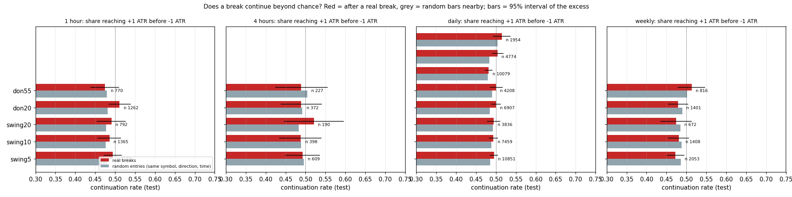
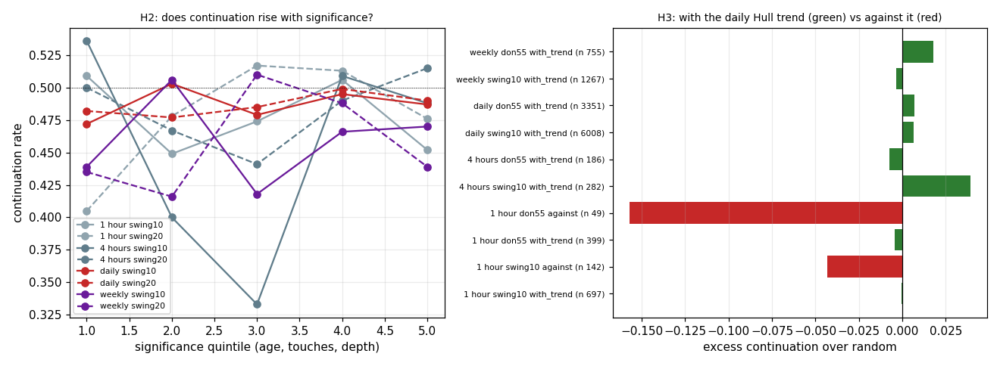
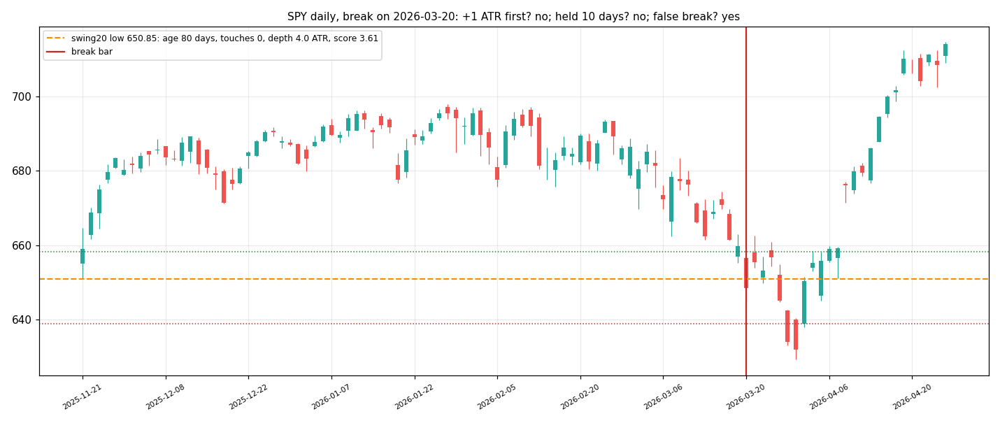

# Structure breaks of significant swings: result

**Breaking a significant swing high or low does not continue the move beyond chance.** On 50,737 daily breaks (177
stocks and ETFs, test years 2023–now) the move reaches +1 ATR before −1 ATR **49.4–49.5%** of the time after a
swing break, against **48.6–49.2%** at random bars of the same stock; the excess is 0.2–0.9 points with intervals
that include 0. The same on weekly bars (−0.7 to −1.4 points), and on 1h / 4h (below). The level's age, touches and
depth do not change it; with-trend breaks are not better than against-trend; the retest variant is not better; a
trend-following rule entered on these breaks loses after costs on daily bars. Pre-registered in PREREG.md;
`verdict.json`, `planted.json`.

## Continuation after a real break vs random entries (test; `real_vs_random.png`)
| timeframe | level class | breaks | continuation after the break | random bars | excess [95%] | hold | false | rule R / trade |
|---|---|---|---|---|---|---|---|---|
| daily | swing 5 | 10,851 | 49.5% | 48.6% | +0.9 [−0.1, +1.9] | 29% | 50% | −0.12 |
| daily | swing 10 | 7,459 | 49.4% | 48.8% | +0.5 [−0.6, +1.7] | 30% | 49% | −0.11 |
| daily | swing 20 | 3,836 | 49.4% | 49.2% | +0.2 [−1.5, +1.8] | 31% | 48% | −0.12 |
| daily | Donchian 20 | 6,907 | 50.0% | 48.5% | +1.6 [+0.3, +2.7] | 31% | 47% | −0.08 |
| daily | Donchian 55 | 4,208 | 50.0% | 49.0% | +1.0 [−0.6, +2.6] | 32% | 46% | −0.14 |
| daily | prior-week H/L | 10,079 | 48.1% | 48.0% | +0.2 [−0.8, +1.1] | 29% | 49% | −0.13 |
| daily | prior-month H/L | 4,774 | 50.4% | 48.3% | +2.1 [+0.7, +3.5] | 32% | 46% | −0.07 |
| daily | 52-week H/L | 1,954 | 51.5% | 50.4% | +1.1 [−1.2, +3.2] | 34% | 45% | −0.08 |
| weekly | swing 5 / 10 / 20 | 2,053 / 1,408 / 672 | 47–48% | 49% | −0.7 to −1.4, all including 0 | 31–34% | 46–49% | +0.10 to +0.15 |
| weekly | Donchian 20 / 55 | 1,401 / 816 | 48% / 51% | 49% / 50% | −1.1 / +1.2, including 0 | 31% / 36% | 47% / 44% | +0.05 / +0.43 |
| 1h | swing 5 / 10 / 20 | 2,189 / 1,365 / 792 | 49% | 48% | +0.9 to +1.5, all including 0 | 24–26% | 39–43% | +0.15 to +0.20 (random bars +0.2 to +0.3) |
| 1h | Donchian 20 / 55 | 1,262 / 770 | 51% / 47% | 48% | +3.0 [+0.1, +5.8] / −0.5 | 31% / 29% | 35% / 38% | +0.22 / +0.02 |
| 4h | swing 5 / 10 / 20 | 609 / 398 / 190 | 49% / 49% / 52% | 49% / 49% / 48% | −0.3 / −0.2 / +3.8 [−3.7, +11.3] | 26–28% | 44–47% | +0.04 to +0.35 |
| 4h | Donchian 20 / 55 | 372 / 227 | 49% | 49% / 51% | −0.3 / −1.6 | 31% / 28% | 43% / 41% | +0.10 / −0.02 |

On 1h and 4h (30 symbols, test days from 2026-03-10) the picture is the same: 47–52% after a break, 48–49% at random.
The trend rule's positive R on 1h, 4h and weekly is **not the break's doing**: the same rule entered at random bars
earns as much or more (weekly: real +0.05 to +0.43 ATR per trade, random bars +0.32 to +0.58; 1h: real +0.15 to
+0.22, random +0.2 to +0.3). It is the 2023–26 drift of these stocks, which any long-biased rule collects.

The two daily classes with an interval above 0 (Donchian 20, prior-month) show 1.6 and 2.1 points: the "edge" of a
coin that lands heads 50.0–50.4% of the time instead of 48.3–48.5%; the trend rule on those breaks still loses
after 5 bp per side (−0.08 and −0.07 ATR per trade). Validation years 2020–2022 show the same sizes (+0.0 to +2.5).

## Significance, context, variants, volume (daily, swing classes; `significance_context.png`)
- **Σ quintiles** (age, touches, depth): continuation 47–50% in every quintile, no slope (H2 rejected). Σ against
  age alone: paired differences +0.01 (not different). Weekly the same.
- **Context**: with the daily Hull trend +0.8 / +0.6 / +0.2 points; against it +4.6 on swing 5 (n small) and no
  events for the larger swings (a break against a confirmed Hull trend is rare by construction). H3 not supported.
- **Variants**: a close ≥ 0.25 ATR beyond, two consecutive closes, or a successful retest first: continuation 47–51%,
  none above the plain break by more than noise; the retest variant (iv) 49% on daily, 51–55% on weekly with few
  events (H4 rejected).
- **Up vs down**: down-breaks +1.7 to +4.8 points on daily (the only consistent sign: breakdowns continue slightly
  more than breakouts), up-breaks 0 to −1.7.
- **Volume**: RVOL of the breaking bar against its size, paired: −0.01 to −0.02 on daily, −0.05 to −0.09 weekly.
  Volume adds nothing here either.
- **Micro-break control** (a close above the prior bar's high): continuation **39%** on daily, 42% weekly: one-bar
  breakouts *reverse* (the well-known short-term reversal in daily stock returns). A swing break is better than that,
  and exactly as good as a random bar.

## Trend rule (enter at the break close, 2-ATR trailing stop or opposite break, 5 bp per side)
Daily: average R per trade −0.07 to −0.14 ATR on every class, hit rate below 40%. Weekly: +0.05 to +0.43 (positive
point estimates on few trades; intervals in `verdict.json`); the same rule at random weekly bars is in the file next
to it for comparison.

## Planted tests
Y0 (regime world with mean-reverting ranges): the detector sees the built-in mean reversion (−4 to −6 points): sane.
Y1 (random walk): real 49.5% vs pseudo 49.1%, no class breaks the rule. Y2 (planted drift after top-Σ breaks):
recovers 96% of the achievable excess. Dated measurement fixes in PREREG: pseudo-entries drawn from the whole series
(a ±30-bar window was conditioned on the rally that caused the break), the Y2 ceiling.

## Hypotheses
H1 big-swing daily breaks continue ≥ 55%: **rejected** (49.4%). H2 continuation rises with Σ: **rejected**. H3
with-trend > against: **not supported**. H4 retest variant best: **rejected**. H5 Donchian 55 / 52-week > swings:
**no** (50–51.5% vs 49.4%, within noise). H6 excess grows with the timeframe: **rejected** (5m −2, 1h / 4h below, daily
+0.5, weekly −1).

## Verdict: no (per the pre-registered rule, no class on any two timeframes)
Nothing is added to the indicator. The 5m markers from the trend model stay as they are.

## Not verified / caveats
Survivorship of the daily universe (current index members only; it favours stocks that went up, which if anything
flatters up-breaks). Yahoo missed BK, ANSS, EA, WBD. The 1h / 4h history is 18 months on 30 symbols. Costs are a
flat 5 bp per side.

