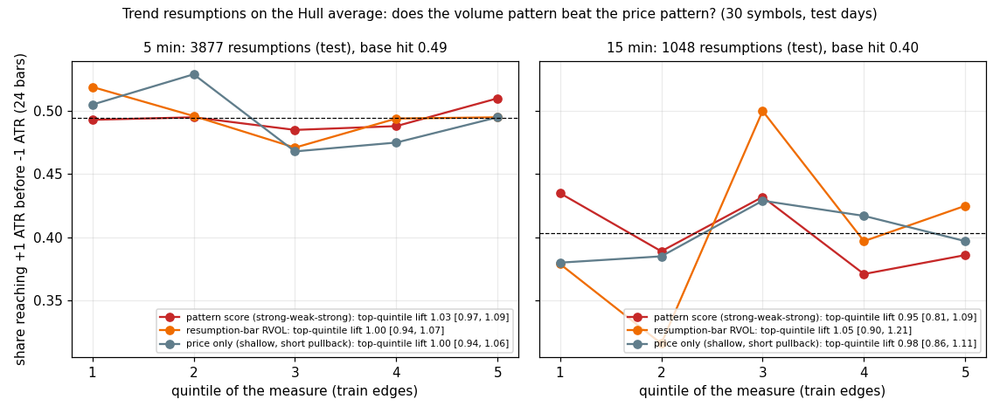
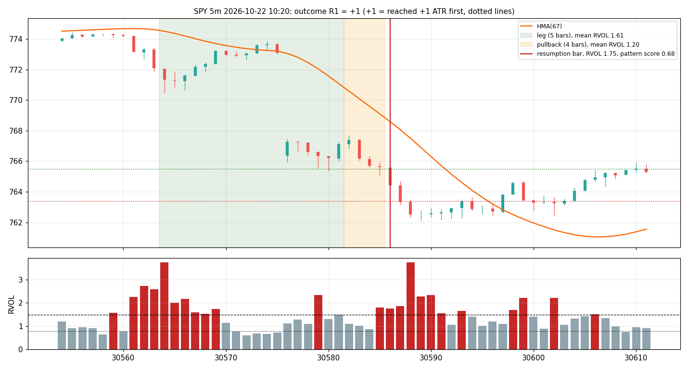

# Volume that supports the trend: result

**Verdict: no.** The price pattern does the work and volume adds nothing. On trend resumptions found on the Hull
average, the strong → weak → strong volume pattern does not raise the chance that the trend goes on, and it does
not beat the price-only control (how shallow and short the pullback was). Test days 2026-03-10 onwards, 30 SIP
symbols, pre-registered in PREREG.md.

## Events
| timeframe | resumptions (train / test) | with a 2-hour outcome | base hit (+1 ATR before −1 ATR) |
|---|---|---|---|
| 5m | 9,387 / 6,166 | 3,877 | 49% |
| 15m | 2,517 / 1,625 | 1,048 | 40% |
| 1h | 0 | — | a 7-bar session cannot hold a 5-bar leg, a 2-bar pullback and a resumption |

## The paired test (top quintile of the measure vs the price-only control, same events; `quintiles.png`)
| timeframe | measure | lift [95%] | control lift | measure − control [95%] | IC |
|---|---|---|---|---|---|
| 5m | **pattern score P** | 1.03 [0.97, 1.09] | 1.00 | **+0.03 [−0.06, +0.12]** | 0.007 [−0.02, 0.04] |
| 5m | resumption-bar RVOL | 1.00 [0.94, 1.07] | 1.00 | 0.00 | −0.014 |
| 5m | leg / pullback volume | 1.01 | 1.00 | +0.01 | −0.005 |
| 5m | trend-volume ratio udR | 1.05 [0.99, 1.11] | 1.00 | +0.04 [−0.04, +0.13] | −0.020 |
| 5m | delta, OBV divergence, effort/result | 0.99–1.00 | 1.00 | ≈ 0 | −0.03 to +0.01 |
| 15m | pattern score P | 0.95 [0.81, 1.09] | 0.99 | −0.03 [−0.24, +0.16] | −0.058 [−0.12, 0.00] |
| 15m | resumption-bar RVOL | 1.05 [0.90, 1.21] | 0.98 | +0.07 [−0.13, +0.27] | 0.014 |

Hit rate by quintile of the pattern score on 5m: 49.3, 49.5, 48.5, 48.8, 51.0%: flat. Groups on 5m: index ETFs
0.78 (295 events, interval −0.63 to +0.01), mega-caps +0.03, high-beta +0.08, all intervals including 0.

The other targets say the same: **R2** (next leg at least as long as the last): the pattern score's lift 1.10 on 5m
equals the control's 1.08 (difference +0.01 [−0.04, +0.06]); on 15m 1.18 vs 1.08 (+0.10 [−0.02, +0.22], not
significant). **R3** (trend still alive after two hours): nothing beats the control; the volume-weighted measures
(delta, udR, effort/result) are **worse** than the control by 0.25–0.44 with intervals excluding 0: a trend whose
leg carried a lot of volume is *less* likely to still be alive two hours later.

## Exhaustion (climax)
| timeframe | volume climax (3 bars RVOL > 2, shrinking ranges) | price-only climax (shrinking ranges) |
|---|---|---|
| 5m | 44 events, reversal 48% [33, 65] | 457 events, 53% [48, 58] |
| 15m | 23 events, 22% [8, 41] | 199 events, 39% [31, 47] |

The volume climax reverses **less** often than the price-only climax, not more; and it is rare (one in ten climaxes).

## Hypotheses
- H1 (the pattern has lift > 1): **rejected** (1.03, interval includes 1).
- H2 (it beats the price-only control): **rejected** on both timeframes.
- H3 (V_res carries most of the effect): moot, there is no effect; V_res alone is exactly 1.00.
- H4 (Hull-of-VWMA is not better than Hull): **confirmed**: at length 67 on 5m test days it has more flips (4.6 vs
  4.2 per 100 bars), more noise (0.070 vs 0.041) and more lag (11.0 vs 8.8 bars).
- H5 (volume climax reverses more than price climax): **rejected**, the opposite direction.
- H6 (first 30 minutes): moot, no event can occur before 35 minutes into the session.

## What was learned
- The events themselves are sound (planted Q2 recovered 107% of a planted effect through the same pipeline), so the
  null is about the market, not the detector.
- Volume along a trend is informative about **size of movement** (reports/volume_tool) and, on R3, mildly about
  **exhaustion in the wrong direction for a trader**: heavy-volume legs die sooner. That is the only volume-and-trend
  signal with an interval excluding 0 here, and it is a warning, not a confirmation.
- The next attempt, if any, should not combine volume with trend state; it should test "heavy-volume leg → trend
  ends sooner" as its own pre-registered claim, with a holding-time target.

## Not shipped
No marker, no alert, no panel line (the rule required "works"). Pine unchanged (v41).

