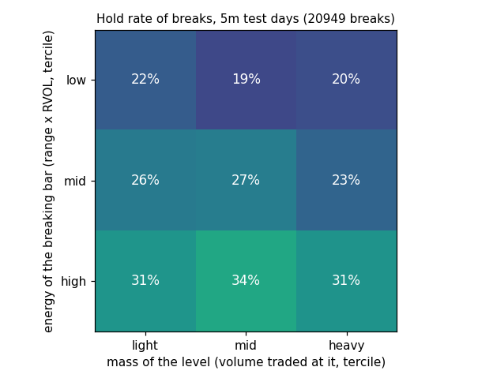
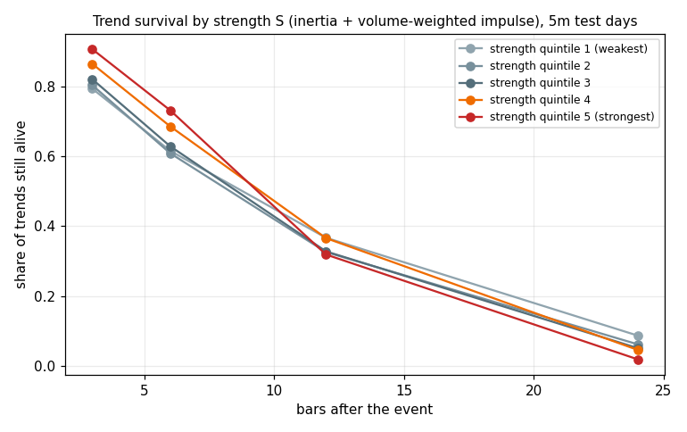
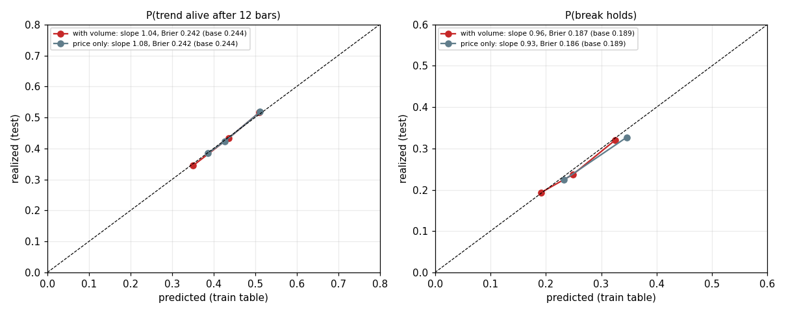
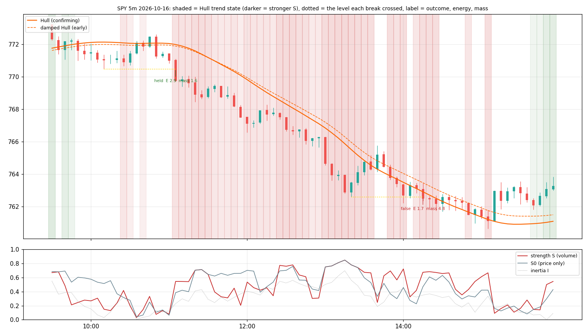

# One trend-volume model: result

**Every volume part of the model lost to its price-only twin. What ships is a price-only model: trend state with a
calibrated strength readout, breaks graded by the bar's size, and three false-break warnings.** 30 SIP symbols,
5m main (15m robustness), test days 2026-03-10 onwards; pre-registered in PREREG.md; `verdict.json`, `ship.json`.

## Component verdicts (5m test days; "twin" = the same formula without volume)
| component | reads | volume version | price-only twin | paired difference | verdict |
|---|---|---|---|---|---|
| (a) impulse J vs J0, trend alive 12 bars | strength of the move | lift 0.91 | 0.98 | −0.07 [−0.09, −0.05] | **drop volume** |
| (a) strength S vs S0, alive 12 | | 0.81 | 0.90 | −0.09 [−0.11, −0.07] | **ship price-only (inverse)** |
| (a) inertia I alone, alive 12 | straightness of the path | — | 0.74 [0.72, 0.77] | — | the driver |
| (b) mass vs time, level respected | weight of a level | 1.005 | 1.003 | +0.00 [−0.01, +0.02] | **drop both** |
| (b) low mass vs short time, break holds | | 1.04 | 1.13 [1.04, 1.21] | −0.09 [−0.16, −0.02] | price-only, weak |
| (c) energy E vs E0, break holds | power of the breaking bar | 1.34 | **1.43 [1.36, 1.51]** | −0.09 [−0.16, −0.03] | **ship price-only** |
| (c) E > activation energy vs E0 > p60 | | holds 29% vs 22% | 32% vs 22% | — | twin rule wins |
| (c) quiet retest vs small retest | retest on lower volume | 0.89 | 0.85 | +0.04 [−0.01, +0.10] | **drop** (both < 1) |
| (c) flags: absorption / wick / exhausted / counter | false break | false 60.5% / 61.7% / 54.5% / 55.0% vs 50% | | intervals exclude the unflagged rate for the first three | **ship 3 warnings** |
| (d) HMM regime check | trending vs ranging | agreement with the Hull state 61% | | | adds nothing (not shipped) |

Same ordering on 15m (6,404 trend events, 646 measurable breaks): every volume-minus-twin difference ≤ 0; flags
point the same way but with wide intervals.

## What the price-only strength says (the surprise of this study; `survival.png`)
Strength S0 = ½ inertia + ½ clipped price impulse. Strong trends live **longer in the near term and die sooner in
the medium term**: still alive after 3 / 6 bars 91% / 73% in the strongest quintile vs 79% / 62% in the weakest; after
12 bars 32% vs 37%; after 24 bars 2% vs 9%. Inertia alone has the steepest gradient (alive at 12 bars 54% → 31% from
the weakest to the strongest quintile). So the readout is a **clock**, not a confirmation: a very straight, fast move
is likely to continue for the next few bars and likely to be over within an hour.
Calibration on test: P(alive12 | direction, S0 quintile) slope 1.08, Brier 0.2424 vs base 0.2445 (small but real).

## What the breaks say (`break_grid.png`)
Hold rate 25%. By the breaking bar's size (E0 terciles, train table): 22% / 26% / 36% on up-breaks, 21% / 25% / 33%
on down-breaks. Level mass changes nothing (grid rows flat across mass). Calibration of P(hold | E0 tercile,
direction): slope 0.93, Brier 0.1864 vs 0.189.
False breaks (back across within 3 bars) are 50% of all breaks; 60.5% on absorption bars, 61.7% when the breaking bar
closes with a long wick back toward the level, 54.5% when the move's inertia is exhausted (bottom quintile). Counter-
trend breaks: 55%, interval overlapping, not shipped.

## Hypotheses
H1 J beats J0: **rejected** (worse). H2 heavier levels respected more: **rejected** (nothing, with time either). H3
E > E_a beats bar size: **rejected** (the twin rule separates better). H4 absorption + counter-trend is the worst:
**partly** (absorption alone 60.5%, the combination 57.4%; the wick flag is the worst at 61.7%). H5 quiet retest
holds more: **rejected** (quiet and small retests both hold less; retest hold base 41%). H6 the HMM adds nothing:
**confirmed** (61% agreement, and no calibration gain).

## Planted tests
Z1 no relation: nothing beats its twin. Z2: energy recovers 77% of a planted hold effect, mass 92% of a planted
respect effect, twins unchanged. (Two dated measurement fixes in PREREG: level ids, and the Z1 rule needing the
volume quantity's own lift above 1.)

## What ships to the indicator (price-only; section «نموذج الاتجاه»)
- Hull trend state (up / down / none) with strength S0 and its quintile, and the calibrated probability that the
  trend is still alive 12 bars later (train table by direction × quintile: 50% → 39% from weak to strong).
- Swing-level breaks (pivots k = 2, level age ≥ 10 bars, same session) marked with the calibrated hold probability by
  the breaking bar's size tercile (22% / 26% / 36% up, 21% / 25% / 33% down).
- Three false-break warnings on the breaking bar: absorption (RVOL > 1.5 with range < 0.7 ATR), wick (close retreats
  more than half the bar from the level side), exhausted (inertia below 0.106); any of them: false-break rate 55%
  vs 49% unflagged.
- A status-panel line and two alerts. Every tooltip says: measured on 5m, 30 symbols, test days; volume was tested
  for every part and did not add.

