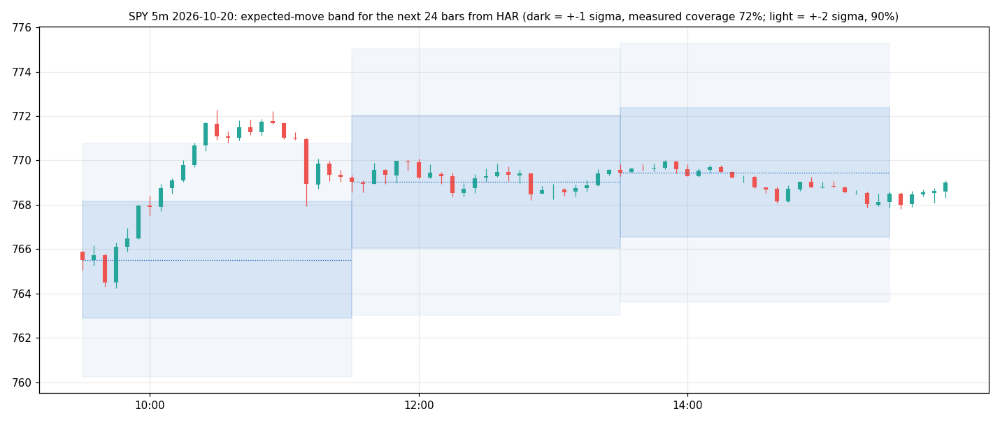
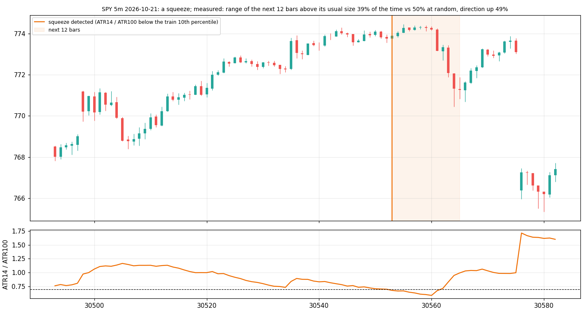
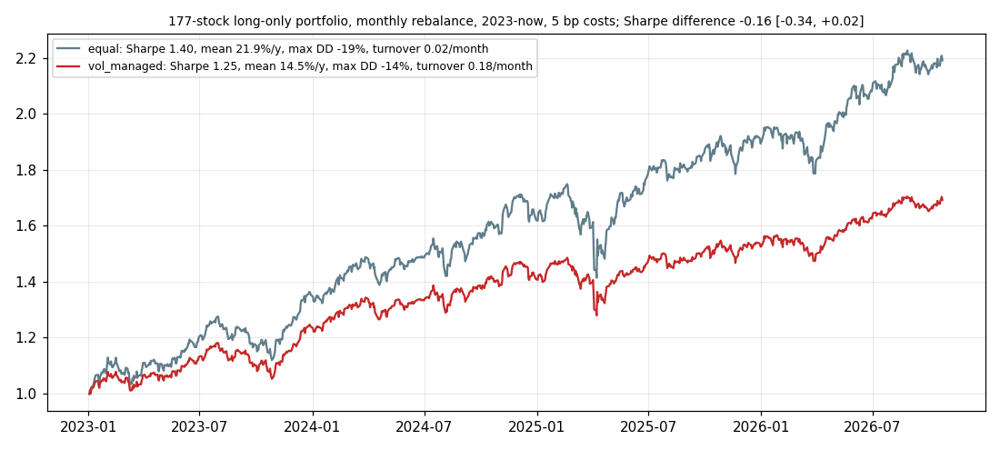
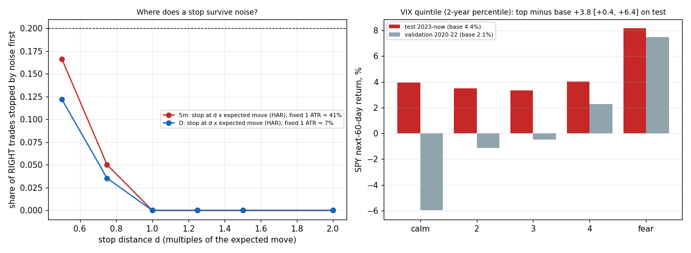

# Volatility engine: result

Five components, each measured against a control on test data (5m: 30 SIP symbols, test days from 2026-03-10;
daily: 177 symbols, 2023–now; pre-registered in PREREG.md; `verdict.json`, `planted.json`).

| component | what it does for the trader | result | ships |
|---|---|---|---|
| **expected move** (band for the next k bars) | how far price is likely to travel | all three forecasts beat the ATR control on 5m (QLIKE −0.24 to −0.60, intervals excluding 0); the Gaussian ±1σ band over-covers (70–77% instead of 68%) because returns have fat tails; only EWMA(0.99) at 24 bars sits inside ±3 points (70.4%; 65% on SPY/QQQ, 71% elsewhere). Daily: ATR is as good as GARCH; EWMA worse; ATR's 5- and 20-day bands cover 72% / 70% | **5m 24-bar EWMA band and daily 5 / 20-day ATR band, as a display with the measured coverage written on it** |
| **squeeze** | expansion soon? | **the opposite**: after a squeeze the next 12 bars expand *less* (38.5% vs 49.7% at random, interval −13 to −9 points); still less at 24 and 48 bars (42%, 46% vs 50%); daily the same sign (90% vs 93%); direction 49–52% | **ships as "calm persists" (62% of squeezes stay quiet for 12 bars), direction 50/50; H3 rejected** |
| **vol-managed sizing** | constant risk per trade | Sharpe 1.25 vs 1.40 unscaled, difference −0.16 [−0.34, +0.02]; mean 14.6% vs 21.9% a year; max drawdown −14% vs −19%; turnover 8× | **dropped** (lower drawdown, but not the Sharpe gain claimed; H5 rejected on 2023–26) |
| **stops** | where a stop survives noise | a fixed 1-ATR stop is hit by noise in **41%** of right 24-bar trades on 5m (7% on daily at 5 days); a stop sized to the horizon's expected move at 0.75× is hit 5% (3.5% daily). Note: "right" is defined by the same expected move, so d ≥ 1 is 0% by construction; the lesson is the scaling, not the number | **ships as a line: stop ≥ 0.75× the k-bar expected move; "1 ATR of one bar is hit 41% of the time"** |
| **fear regime** (daily, SPY / QQQ) | context | top-quintile VIX (2-year percentile) → next 60 days **+3.8 points above base** on SPY (test, [+0.4, +6.4]; validation +5.4 [+1.9, +8.2]), **+5.9** on QQQ ([+0.5, +9.6]; validation +7.0); 20-day tilt positive but intervals include 0 on test; VIX above VIX3M (backwardation) → +6.5 / +9.5 points at 60 days | **ships as a context line with these numbers; H7 confirmed** |

## Forecasts in detail (`verdict.json`, `band_SPY.png`)
5m, 24 bars: QLIKE EWMA −7.574, GARCH −7.564, HAR −7.630, ATR −7.030 (all three vs ATR: intervals far from 0).
Coverage ±1σ / ±2σ: EWMA 70.4 / 89.1, GARCH 74.8 / 91.2, HAR 71.6 / 90.1, ATR 67.5 / 84.8. By group (EWMA, ±1σ):
index 64.7, mega 71.4, high-beta 70.3. 6 bars: every band covers 74–77% (fails ±3).
Daily: 1 day: GARCH / HAR beat ATR by 0.02 (tiny), EWMA(0.94) is worse than ATR by 0.08; 5 and 20 days: GARCH ≈ ATR.
Coverage ±1σ: ATR 75 / 72 / 70 (1 / 5 / 20 days), EWMA 74 / 71 / 68, GARCH 77 / 74 / 73.
Reading: the forecasts rank variance well (QLIKE) but a Gaussian band drawn from them is 2–9 points too generous at
±1σ and 2–6 points too tight at ±2σ: fat tails. A trader should read the band as "about 70% inside", which is what the
tooltip says. GARCH parameters (pooled, standardized): 5m α 0.29, β 0.66; daily α 0.08, β 0.86 (persistence 0.94).

## Squeeze (`squeeze_SPY.png`)
5m ATR-squeeze (ATR14 / ATR100 < 0.70, 3,891 events): expansion within 12 bars 38.5% vs 49.7% random; 24 bars 42.4 vs
49.6; 48 bars 45.6 vs 49.9. Bollinger-width squeeze (5,109): 44.7 vs 49.7. Daily: 90–94% vs 93–95% (the "above the
train median" target is nearly always met in 2023–26, a more volatile period; the random comparison is still fair
and shows no lift). Direction after a squeeze: 48.4–52.2% up. Calm persists; it does not announce a move.

## Sizing (`equity.png`)
Long-only 177 stocks, monthly, 2023-01 to 2026-10, 5 bp: equal weight 21.9% a year, vol 15.7%, Sharpe 1.40, max
drawdown −19.2%; vol-managed (target = 2010–2019 median vol, cap 2×) 14.6%, 11.7%, Sharpe 1.25, −13.9%, turnover
0.18 a month. In a rising market, scaling down after every volatility spike gave away return faster than risk.

## Stops (`stops_fear.png`)
5m, 24-bar horizon, 4,422 right trades: noise stop-outs at 0.5× / 0.75× the expected move 16.6% / 5.0%; fixed 1-ATR
stop 41.1%. Daily, 5-day: 12.2% / 3.5%; fixed 1-ATR 7.4%. Target-before-stop (stop 1×, random entries, undecided
trades excluded from the hit but counted in the base): 1× target 24.6%, 2× 8.5%, 3× 3.7% on 5m; about half of all
random entries reach neither ±1× within the horizon.

## Fear regime (`stops_fear.png`)
SPY 60-day forward return by VIX quintile (test 2023–26): 4.0, 3.5, 3.3, 4.0, **8.2%** (base 4.4%); validation
2020–22: −6.0, −1.2, −0.5, 2.3, **7.5%** (base 2.1%). QQQ test: 4.4, 5.7, 4.7, 5.4, **11.9%**. Backwardation vs
contango: +6.5 (SPY), +9.5 (QQQ) at 60 days. The slow, old fact holds: buy fear, at a horizon of months.

## Hypotheses
H1 GARCH beats ATR on 5m QLIKE: **confirmed** (6 and 24 bars). H2 ±1σ covers 68 ± 3: **rejected** for GARCH / HAR
(fat tails), met by EWMA at 24 bars only. H3 squeeze doubles expansion odds: **rejected, opposite sign**. H4 squeeze
says nothing about direction: **confirmed**. H5 vol-managed Sharpe +0.2: **rejected**. H6 1-ATR stop hit > 35% by
noise, horizon-scaled stop < 20%: **confirmed** on 5m (41% → 5%), partly on daily (7%). H7 top-quintile VIX →
positive 60-day tilt: **confirmed** on test and validation, SPY and QQQ.

## Planted tests
V1 constant world: GARCH finds no clustering (α 0.003), band 67.9%, squeeze interval includes 0. V2 GARCH world:
forecast R² 0.91 against the true variance, band 69.7%, planted squeezes expand 68% vs 50%. Seven dated measurement
fixes in PREREG (likelihood order, subsample order, control units, planted-window lengths, gate lines).

## Not verified / caveats
IV is not stored by GEXRadar, so no VRP. The 5m test is 18 months on 30 symbols; the index-ETF group's band covers
65%, under the ±3 line (the rule's every-group clause is missed by 0.6 points; the band ships as a display with the
number on it, not as a claim). Daily universe = current index members (survivorship). The stop study's "right trade"
is defined by the same forecast it tests, so only the comparison with the fixed-ATR stop is meaningful.

